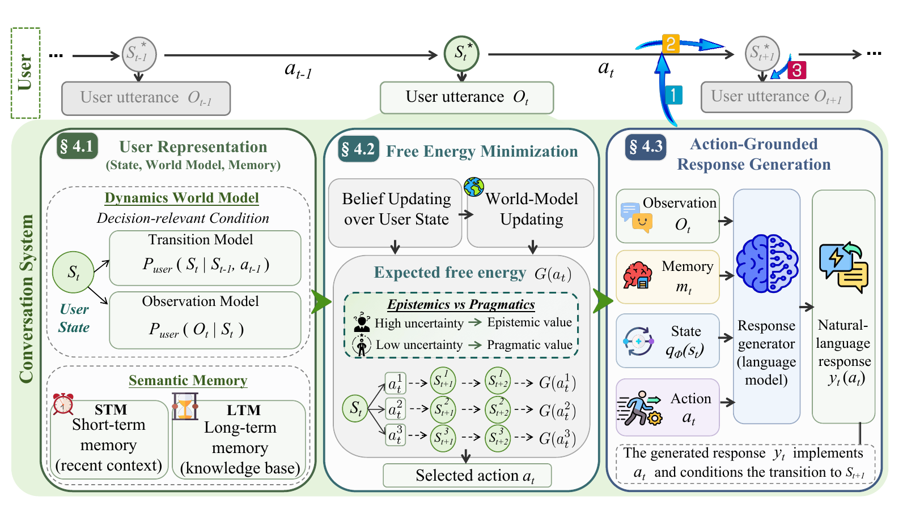
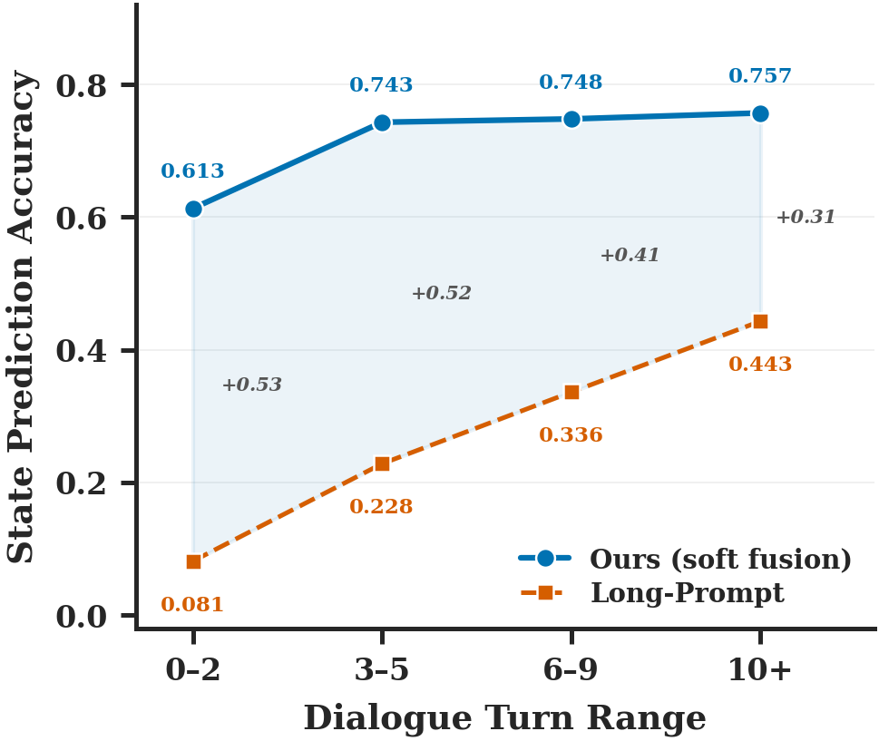
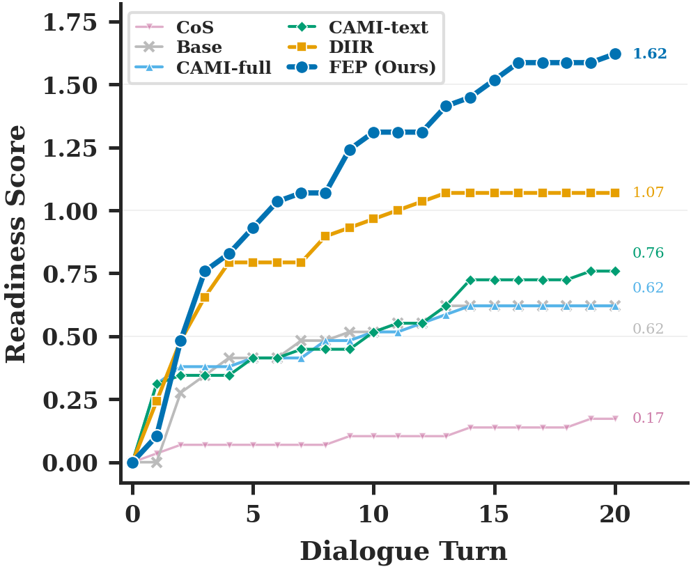

<h1 align="center">PUMA</h1>

<h3 align="center">
  Know You Before You Speak:<br>
  User World Modeling for LLM Personalization in Multi-Turn Conversation
</h3>

<p align="center">
  <strong>Prospective User World Modeling for Action Selection</strong><br>
  Understand the hidden state. Anticipate the next turn. Choose how to respond.
</p>

<p align="center">
  <a href="https://github.com/Annie1161/PUMA"></a>
  <a href="LICENSE"></a>
  <a href="README.zh-CN.md"></a>
</p>

<p align="center">
  <strong>English</strong> | <a href="README.zh-CN.md">简体中文</a>
</p>

<p align="center">
  <a href="#motivation">Motivation</a> ·
  <a href="#overview">Overview</a> ·
  <a href="#results">Results</a> ·
  <a href="#installation">Installation</a> ·
  <a href="#data">Data</a> ·
  <a href="#offline-evaluation">Offline evaluation</a> ·
  <a href="#interactive-evaluation">Interactive evaluation</a>
</p>

> **The same words can carry different meanings in different user states.**
> An observation alone does not uniquely reveal the user's true state. PUMA maintains
> a belief over that hidden state and uses a user world model to reason about how
> different responses may shape what happens next.

## Motivation

An utterance provides only a partial observation of a user's underlying state.
Factors such as uncertainty, engagement, and readiness to act influence what the
user means, but may remain implicit in what they say. As a result, the same
utterance can reflect different states and call for different response strategies.

Consider the same observation: **“I've been taking the new medication for two weeks.”**

| Possible hidden state | What the utterance might mean | What the response should explore |
| --- | --- | --- |
| Anxious about side effects | “I need reassurance about what I am experiencing.” | Invite the user to share their concerns. |
| Confidently tracking progress | “I am updating you on how things are going.” | Ask about progress and the user's experience. |
| Unsure about continuing | “I am reconsidering whether to keep going.” | Clarify the hesitation and the user's intentions. |

*Illustrative interpretations adapted from the manuscript's motivating example.*

Selecting an appropriate response therefore requires inferring the user's current
state from the dialogue history and current utterance. It also requires anticipating
how the response itself may affect the user's subsequent state. **PUMA connects
these two tasks through a user world model:** it maintains and updates a belief over
the user's state, predicts how that state may evolve under candidate dialogue actions,
and selects an action that balances uncertainty reduction with progress toward the
dialogue goal. The selected action then guides response generation.

## Overview

Grounded in the Free Energy Principle (FEP), PUMA treats personalization as
decision-making over a **partially observable, evolving user**. Its user world model
connects latent states, observable utterances, and state transitions conditioned on
system actions.

<p align="center">
  <a href="assets/puma-framework.png"></a>
</p>

<p align="center"><sub>From observing an utterance to understanding possible states and anticipating future interaction.</sub></p>

| Component | Role in the interaction |
| --- | --- |
| **State belief** `q(s)` | Maintain uncertainty over the user's current hidden state, updating it as dialogue evidence arrives. |
| **Observation model** `p(o \| s)` | Represent how a latent state may be expressed in an observable utterance. |
| **Transition model** `p(s′ \| s, a)` | Predict how a candidate system action may change the user's state. |
| **Prospective action selection** | Approximate expected free energy (EFE) to balance uncertainty reduction and goal-directed outcomes. |
| **Memory and generation** | Ground the selected action in user context and realize it as a natural-language response. |

The interaction follows a repeated cycle: **observe → update the state belief and
world model → evaluate candidate actions → respond → observe again**. The belief
remains an estimate that can be revised as new evidence arrives.

The current implementation instantiates this framework in motivational interviewing
(MI), using **precontemplation → contemplation → preparation** as readiness states.
Offline evaluation also supports **neutral / change / sustain** talk-type labels.
World-model refinement updates structured observation and transition rules through
LLM inference during interaction; the supplied workflows run inference and evaluation.

## Results

The accompanying manuscript evaluates state tracking on fixed transcripts and
long-horizon interaction with a profile-grounded patient simulator. The figures and
values below are reported in that manuscript.

<table>
  <tr>
    <td align="center" width="50%"><strong>Tracking the hidden state</strong></td>
    <td align="center" width="50%"><strong>Anticipating user evolution</strong></td>
  </tr>
  <tr>
    <td><a href="assets/state-prediction.png"></a></td>
    <td><a href="assets/readiness-progression.png"></a></td>
  </tr>
</table>

The left figure shows next-state prediction across dialogue stages. The right figure
shows readiness progression in CAMI simulator rollouts; **FEP (Ours)** denotes PUMA
in the original figure legend.

| Backbone | Stage lift ↑ | Preparation rate ↑ | Trigger coverage ↑ | Average turns ↓ |
| --- | ---: | ---: | ---: | ---: |
| Qwen3-8B | 1.62 | 75.9% | 62.4% | 12.2 |
| Llama-3.1-8B | 1.76 | 83.0% | 63.2% | 10.7 |

*PUMA results reported under the manuscript's CAMI patient-simulator protocol.*

## Installation

### Set up the environment

```bash
git clone https://github.com/Annie1161/PUMA.git
cd PUMA
python -m venv .venv
source .venv/bin/activate
python -m pip install --upgrade pip
```

[requirements.txt](requirements.txt) is the bundled environment snapshot. It pins
`torch==1.13.0+cu117` and `transformers==4.37.0`, among other packages. These pins are
**not a validated Qwen3 environment**. The Qwen3 examples below require a compatible
PyTorch, Transformers, and CUDA setup; reconcile the snapshot with that setup before
installing dependencies. The CUDA-specific wheels may require a matching package index.

For an environment using the bundled pins:

```bash
python -m pip install -r requirements.txt
```

The memory module also loads the spaCy English model:

```bash
python -m spacy download en_core_web_sm
```

Run subsequent commands from the repository root. Make the shared modules and agent
entry points importable in the current shell:

```bash
export PYTHONPATH="$PWD/src:$PWD/src/agent${PYTHONPATH:+:$PYTHONPATH}"
```

### Choose a local model

Inference uses a local Hugging Face causal language model. Pass `--model` with a
model identifier or an existing local model directory. The agent defaults to
`Qwen/Qwen3-0.6B`; the rollout evaluator defaults to `Qwen/Qwen3-8B`.
The agent default can also be overridden with the `PUMA_MODEL` environment variable.

Local inference is implemented in `src/agent/counselor.py`. Dynamic evaluation shares
the loaded model between the counselor and patient simulator.

## Data

Prepare datasets separately and follow their original access and license terms. The
examples below assume this local layout:

```text
data/
└── cami/
    ├── profiles.jsonl
    └── profiles_misc.jsonl
```

CAMI profiles use one JSON object per line. Dialogue fields include `speakers`,
`utterances`, `states`, `talk_types`, and `actions`; persona fields include `Personas`,
`Beliefs`, `Motivation`, and `Acceptable Plans`. The population statistics additionally
use `misc_actions` for counselor MISC labels. Keep per-turn arrays aligned.

Provide prepared transcripts and annotated profile files in the formats above.

Pass data paths and evaluation settings explicitly through CLI arguments.

## Offline evaluation

Once the model environment and data are available, evaluate state predictions against
a fixed CAMI transcript. Start with a small profile count:

```bash
python src/agent/main.py \
    --dataset cami \
    --data_path data/cami \
    --data_name profiles.jsonl \
    --model Qwen/Qwen3-8B \
    --state_label_space cami_stage \
    --persona_state_space cami_stage \
    --observation_focused_state True \
    --prior_fusion_mode soft_fusion \
    --test_num 5 \
    --results_file logs/results/puma_static.json
```

## Interactive evaluation

Run counseling rollouts for five profiles with a maximum of 20 turns per profile.
This example explicitly enables EFE action selection and soft fusion of the
observation-based estimate with the planner's predicted prior:

```bash
python src/tools/eval_simple_sim.py \
    --profiles_misc_path data/cami/profiles_misc.jsonl \
    --model Qwen/Qwen3-8B \
    --test_num 5 \
    --max_turns 20 \
    --seed 42 \
    --fep_efe_action True \
    --prior_fusion_mode soft_fusion \
    --output_json logs/results/simple_sim_puma_n5.json
```

The output contains aggregate metrics and per-profile trajectories, including stage lift,
preparation rate, turn count, trigger coverage, and action distribution. The evaluator
runs the PUMA counselor with the local patient simulator.
